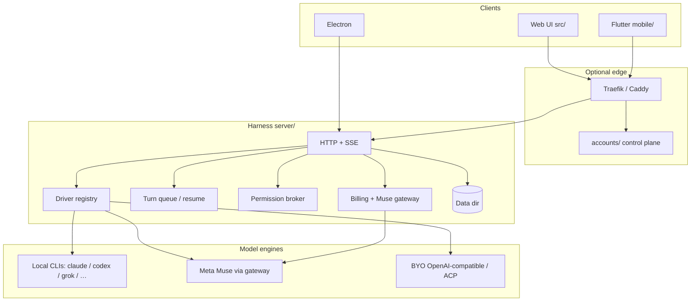

# Architecture

Maximus splits into a **harness server** (agents, tools, data) and thin
**clients** (web, desktop, phone). Clients issue typed HTTP commands and fold
one SSE event stream. They do not own agent transports.

## Harness (`server/`)

| Piece | Role |
| --- | --- |
| `index.ts` | HTTP routes, SSE bus, turn orchestration |
| `drivers/` | One adapter per engine (CLI stream-JSON, ACP, OpenAI-compat, Meta, …) |
| `contracts.ts` | Driver SPI — keep small; new providers plug in here |
| `request-auth.ts` | Loopback trust, paired sessions, `admin` vs `client` scopes |
| `billing/` | Plans, wallets, checkout, **gateway** (pooled keys never leave here) |
| `turn-resume.ts` | Durable turn queue across restarts |
| `context-budget.ts` | When to compact long threads (huge Muse windows fold early) |
| `phones/` | Phone-apps job protocol for the companion |
| `browser/` | Agent browser + teach-session recorder |

Canonical runtime events are normalized per thread (NDJSON). Approvals and
risky tools go through the permission broker as chat cards.

## Clients

| Client | Talks to harness via | Auth |
| --- | --- | --- |
| Web (`src/`) | Cookie / session after pair or email/OAuth | Browser |
| Desktop (`electron/`) | Embedded child port + web session | Loopback owner + optional remote pair |
| Mobile (`mobile/`) | Companion token / session cookie | Pair code or account sign-in |

Shared wire shapes live in `shared/` (and mirrored Flutter models in
`mobile/lib/api/models.dart`).

## Full-product stack (Coolify)

Production meetnote runs four compose services:

1. **postgres** — accounts DB  
2. **accounts** — signup, OTP, memberships  
3. **accounts-cron** — scheduled account jobs  
4. **chat** — harness image from `dist-server` + `dist`

Traefik on the external `coolify` network terminates TLS for
`app.meetnote.cc` and `accounts.meetnote.cc`. Chat data is a Docker volume at
`/data` (config, sessions, bots, usage, billing wallets).

Deploy from a laptop: [Coolify README](../deploy/coolify/README.md) ·
`pnpm deploy:vps`.

## Auth and scopes

- **Loopback owner** — local desktop/dev; full admin unless restricted.  
- **Paired session** — device redeems a code; scopes from the pairing or
  sign-in allow-list (`MAXIMUS_SIGNIN_ADMINS` / members, or first password
  owner).  
- **`admin`** — usage, engines, config, people.  
- **`client`** — chat, read session, limited bot look patches.

## Data

| Location | Contents |
| --- | --- |
| `config.json` | Engines, context.compactAt, sign-in lists, defaults |
| `sessions.json` | Device sessions + scopes |
| `bots.json` / `bots/` | Bot profiles and per-bot state |
| `messages.db` | Transcripts |
| `billing/` | Wallets, plans, pool Meta key |
| `usage/` | Ledger + spans (latency diagnosis) |

## Related docs

- [Runtime contract](runtime-contract.md)  
- [Self-hosting](self-hosting.md)  
- [Verification](verification/README.md)  
- [MCP server](mcp-server.md)  
- [Headless CLI](headless-cli.md)  
