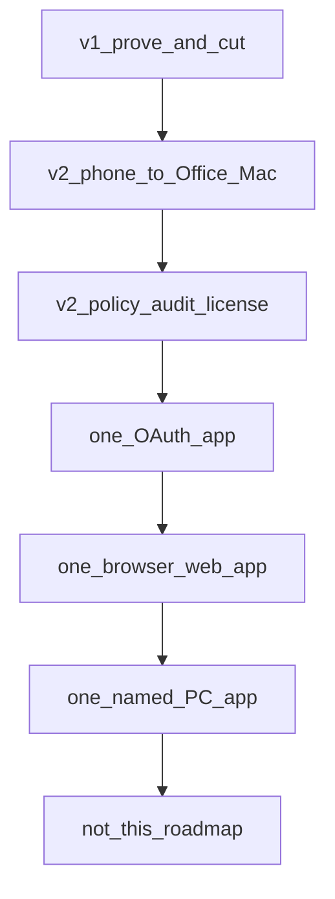

# Maximus product roadmap (v1 then v2)

Date: 2026-11-15. This is the only product sequence. Do not open a parallel
ERP, Bybata, Flutter-HTML, or “fifty connectors” track.

Two ships, same tree:

1. **v1 — kernel.** One harness, three clients, many engines. Computer use
   on **this** desktop while the app is open. Prove it and cut a version.
2. **v2 — Agent OS.** Same kernel. From the phone, pick Office Mac, approve
   one action, see the result in that thread. Then one real app in each
   plug-in family.

v2 does not start until v1’s cut is done. Agent OS code already in tree is
a skeleton; it is not a reason to skip v1 gates or to jump to Figma/Canva.

Public origins stay `https://app.meetnote.cc` and
`https://accounts.meetnote.cc`. Hosting is Coolify on the VPS
([2026-11-11](2026-11-11-vps-full-product-roadmap.md)).
`maximus-enterprise/` stays the license gate.

---

## How to use this file

Work the next open gate. A v2 PR that lands before the v1 cut is a digression.
A Mode C / ERP / Canva PR that lands before the phone→Office Mac loop is a
digression. Reject those in review.

**Do not:** Flutter full ChatKit RPC, `erp_*` tables, Railway as host, a
second company tenancy design, a shared company Canva password, BybataBot.

---

# Ship 1 — v1 kernel

**Line:** Maximus — the multi-engine workspace.

**For:** developers and small teams who want one chat for several engines,
local computer use on the desktop, custom MCP, and work that keeps running
after the window closes.

**Limits the notes must name:** the desktop app must be open for local
computer use; the phone draws confirm/cancel widgets and sandboxed HTML
frames, not a full ChatKit host.

Baseline in tree: phone reconnects `/api/events`; Meta retries like the
other chat drivers. Version: `package.json` and Flutter `0.1.145`. Manual
passes below are still open.

**Status 2026-11-15 (tree vs people):** Isolated fixture proofs for V1.1
two-engine + doctor + phone Bearer send, V1.2 widget retry, V1.3 injected
529, V1.4 `pnpm bench:persistence` numbers in
[2026-11-14-maximus-v1-release.md](2026-11-14-maximus-v1-release.md), V1.5
workspace restore + `PRAGMA integrity_check` + `DEV_OTP_LOG` production
throw. Still people: three-client GUI, real airplane radio, live vendor 529,
quiet-lab bench, live VPS/OTP/new account, version cut and store publish
(only after a person has V1.1 + V1.2 on that commit). Version remains
`0.1.145`.

## Frozen in v1 (do not grow the list)

| Surface | In v1 |
| --- | --- |
| Engines | Claude, Codex, Grok, Gemini, Muse Code, OpenAI-compatible, custom ACP CLI |
| Clients | Web, desktop (Electron), phone (Flutter). One HTTP API + `GET /api/events` |
| Desktop | macOS and Ubuntu GNOME (**Xorg** and **Wayland**) CUA, in-app Chromium, local stdio MCP |
| Inline UI | `show_widget` / `show_html` on web, desktop, and phone (phone: confirm/cancel widgets + sandboxed HTML frame) |
| Durability | Turns run on the harness; restart reruns a cut turn once unless it already sent, posted, or paid |
| Keys | BYO + CLI logins, custom MCP, pooled Muse gateway |
| Host | One VPS, Coolify, Postgres accounts, chat at `/data` |

Already done (do not rebuild): search worker, web live-stream reconnect,
driver retries, phone read cache, phone send outbox, hosting phases 0–5.

## v1 gates (one commit, isolated fixture)

Follow `docs/verification/README.md`. Never mutate live meetnote data.

### V1.1 Prove the freeze on three clients — people (accepted); fixture in tree

Same account, same bot: web sign-in and two-engine thread continuity; one
approved GUI action on macOS and Ubuntu GNOME (Xorg and Wayland);
one MCP read and send from Cursor or Claude Desktop; `show_widget` /
`show_html` on web, desktop, and phone; phone send + confirm/cancel.

### V1.2 Phone stream after airplane mode — done in tree (radio still a person)

Radio back: missed messages appear, composer still sends, no duplicate
optimistic row. A failed send is queued locally (same `sendId`) and
flushed on Retry, stream hello, or app resume.

### V1.3 Retry drill — in tree (fixture still a person)

One injected 529 completes; a bad key fails first try. Claude, Codex, Grok,
Muse Code, OpenAI-compatible, Meta. Automated: `server/drivers/retry.test.ts`,
Meta 529, engine-error copy. Live 529 per engine still needs a fixture.

### V1.4 Persistence bench — people (accepted; recipe unchanged)

`pnpm bench:persistence` on a quiet machine; numbers in the release notes.
Do not move SQLite writes off the main thread unless a normal send stalls.

### V1.5 Production host — people / ops (accepted; do not mutate live meetnote)

Health on app + accounts; real OTP (no `DEV_OTP_LOG` in prod); one new
account turn; `pnpm deploy:vps`; restore drill onto a **fresh** volume;
`PRAGMA integrity_check`. No new billing gateway.

### V1.6 Cut — people (accepted; publish when a person has V1.1 + V1.2)

`docs/releasing.md` + `mobile/STORE_RELEASE.md`. One version. Publish only
after V1.1 and V1.2 pass on that commit.

**v1 done when those six pass.** Then — and only then — v2 work is the
front of the queue.

---

# Ship 2 — v2 Agent OS

**Line:** Maximus with Agent OS. Same kernel. You pick the machine.

Maximus stays chat, engines, MCP, CUA, approvals, web/desktop/phone.
Agent OS is named machines, “run this there,” **this person’s login**,
policy, audit. Figma, Canva, Cursor, Tally, a POS are **apps**. Maximus
does not clone them and does not keep a second copy of their data.
Colleagues who never open Maximus keep using those apps as today.

**Today (tree):** Electron heartbeats; one overlay list; `runsOn` bind;
dispatch via CUA or shared-computer lease; asleep wait card / fail in thread
(never the phone’s cloud); approvals name machine and who approved; policy +
Activity + `agentOsMachines`. Mode A lists and comments on Figma as that
person’s Composio account (confirm on comment). Mode B Canva Publish attaches
this desktop’s Chromium partition over CDP after confirm; phone/hosted web
only approve. Mode C assembles a PR as that git user on this computer
without contacting origin; a remote PC is a lease. ERP post is still not a
live voucher.

**v2 headline (Agent OS v0.1):** from the phone, pick Office Mac, approve
one click or file action, see it in the same thread; the phone does not
execute computer-use. If the Mac is asleep, the thread says so. Until that
works, web-app plug-ins are just more chat tools.

OSS stays this computer + optional cloud home. Extra machines need
`agentOsMachines`.

## v2.1 One live list — done in tree

Electron heartbeats while the app is up; quit/sleep goes grey within
`AGENT_OS_STALE_MS`. Overlay lent desktops, cloud home, team boats onto
`{ id, name, kind, online, capabilities }`. Same list on web, desktop,
phone. No second pairing protocol.

## v2.2 Bind the next turn — done in tree (wait card + fail)

Thread/bot `runsOn: machineId`. Phone Named computers / chat menu writes
it. Web Access does too. Asleep → wait card or fail in thread. Never
silently run on the phone’s cloud.

## v2.3 Dispatch for real — done in tree

This process → today’s CUA / in-app browser (or cloud-home path).
Another live desktop → existing shared-computer lease. Not SSH.
Phone and hosted web never gain raw CUA.

## v2.4 Approval names the machine — done in tree

Existing cards + which machine + who approved. Per-person logins /
Composio / sign-in cards. No password in the transcript.

**v2 ship gate:** the phone→Office Mac loop. Ship that before any app
family.

## v2.5 Policy, audit, license — done in tree

Admin Settings writes the policy file (bots, machines, computer / browser /
connector). Policy only **narrows**. Activity answers “who clicked the till
last Tuesday.” License actually grants `agentOsMachines`; unlicensed
workspaces cannot route to a second PC.

## v2.6 Three proofs — after v2.1–v2.4 are in production

**Tree:** A list + confirmed comment HTTP as that Composio account; B confirm
+ CDP attach on this desktop (phone/web approve only); C git PR payload as
that user, origin not contacted. **Tree also:** a paired-phone fixture picks Office Mac, routes through the
shared-computer lease, and only approves Canva (no CDP). The phone Named
computers screen approves Figma/Canva/git as that person; the result (or
asleep wait) is a line in that thread. Mode B clicks Publish on an
already-open Chromium page after attach (never opens Canva.com). **Still
pending (people / hardware):** a real Mac, a live Canva Publish on that
desktop, a `gh` PR to origin, and V1 prove-and-cut.

Next app = pick A/B/C + bind identity. API first; GUI only as fallback
with a bigger confirm. No shared SQL for posting.

| Mode | When | v2 proof (one each) |
| --- | --- | --- |
| A API / OAuth / MCP | Vendor has an API | Figma or an existing Composio app: list/comment as that person; audit names person, account, machine |
| B Browser as user | Web app, weak API | One site (e.g. Canva): their Chromium partition on the **named desktop**; confirm before Publish. Phone/web only approve |
| C Named PC | Desktop / LAN / folder | One action set: ERP lookup/post behind a voucher confirm, **or** a Cursor repo (edit/test/PR as their git user). Not both in the first slice |

Mode A is Agent OS when audit names person, account, and machine. Mode C in
this slice is the git PR as that user, not ERP.

## Clients in v2

| Client | Select | Approve | CUA / CDP | Vendor API |
| --- | --- | --- | --- | --- |
| Phone | Yes | Yes | Never | Server, as that person |
| Hosted web | Yes | Yes | Never | Server, as that person |
| Desktop | Yes | Yes | Yes, if **this** machine is the target | Yes, as that person’s OAuth |
| Cloud home | Harness | — | Own cloud path only | Yes, as that person |

## Files (extend, do not replace)

`shared/agent-os.ts`, `server/agent-os.ts`, `server/routes/agent-os.ts`
(keep HTTP off `server/index.ts`). Heartbeat in `electron/` and cloud home.
Overlay `SharedComputers`, team computers. Dispatch: CUA, CDP, shared-computer
lease. Phone: `machines_page.dart` + thread bind. Web: `AgentOsMachines`,
`AgentOsRunOn`.

---

# After v2 (not scheduled here)

Only if a second company appears: tenancy beyond one data dir + today’s
workspace row. **Do not add Railway.** Host is the existing VPS + Coolify
(`docs/plans/2026-11-11-vps-full-product-roadmap.md`). `deploy/railway-accounts.md`
is leftover env-var shape, not a second host.

Still never on this roadmap: Maximus as Figma/Canva/Cursor/Tally; a PC that
is off; one Maximus login that is admin in every SaaS; pixel-perfect forever
GUI; fifty connectors; books inside Maximus SQLite.

---

## Queue (people work)

1. V1.1 / V1.4 / V1.5 / V1.6 — people (accepted). V1.2 and V1.3 in tree.
2. ~~v2.1 heartbeat + one list.~~
3. ~~v2.2 bind `runsOn`.~~
4. ~~v2.3–v2.4 dispatch + named approval.~~ Phone→Office Mac **fixture** is in
   tree; a real Mac is still people.
5. ~~v2.5 policy / Activity / license.~~
6. ~~Mode A comment / Mode B CDP attach / Mode C git PR (no origin).~~ Live
   Canva click and a GitHub `gh pr create` still need that desktop.

That is the year if v1 is done: a real machine list, phone routing that
runs, an audit an admin can read, then three proofs. “Login to anything”
is the horizon, not the next PR.
